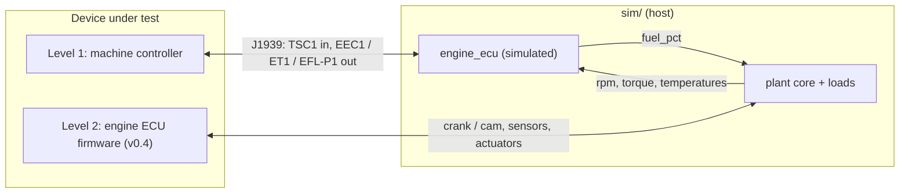

# Architecture

This document explains how open-crank is structured and, for each decision, *why*. Where a decision departs from the earlier README or the first vertical-slice branch, it says so. Interface sketches are **proposals for v0.1**, not frozen APIs.

## 1. Goals the architecture must serve

1. **The same control source runs on a laptop, in an emulator and on a real board.** This is the reason the project exists. Everything below follows from it.
2. **The plant answers back honestly.** It is physics. It does not secretly help the controller under test.
3. **SIL/HIL parity.** The plant core never knows whether it runs in CI or on an FPGA rig.
4. **Determinism where it matters, and only there.** Tests must be repeatable bit for bit; only the HIL path needs hard real time.
5. **A solo maintainer can keep it in their head.** Small number of modules, narrow interfaces, nothing speculative.

## 2. System overview

Two kinds of device under test (DUT) can face the plant. v0.1 to v0.3 support Level 1; v0.4 adds Level 2.



**Why two levels.** In a real engine, the *engine's own ECU* speaks J1939 and the machine's controller talks to it. The first draft let the plant publish J1939 directly and let the "ECU under test" command throttle over CAN, which no real machine does. That blurred who is under test and made a Level 2 future impossible. Making the levels explicit fixes the meaning of every message and shows where the plant ends and the controller begins.

**Why Level 1 first.** EMS and PMS are supervisory controllers, so Level 1 matches the stated use case. It needs only a CAN bus, so it works with `vcan` and no special hardware, and it is where the learning value is cheapest.

## 3. The three zones and the dependency rule


| Zone | Contains | May depend on | Must not contain |
|---|---|---|---|
| `portable/` | J1939 codec, machine-controller logic | nothing but the C standard headers `<stdint.h>`, `<stdbool.h>`, `<stddef.h>` | `printf`, `malloc`, files, sockets, OS calls, the plant, `double` where avoidable |
| `sim/` | plant physics, plants, loads, simulated engine ECU, clock modes, scenario runner | `portable/` | sockets, a specific OS, firmware HALs |
| `platforms/` | SocketCAN, Renode glue, STM32G4 HAL, FPGA glue | `portable/` and `sim/` | control logic, physics |

**The rule: dependencies point one way, and `portable/` depends on nothing else in the repo.**

**Why.** Without a hard rule, the reference controller drifts into a Linux program: it picks up `printf`, `atof`, sockets and `double` math, and then it cannot be compiled for the STM32 or run in Renode. That is exactly what happened in the first slice, where the "reference firmware" was a Linux process. A folder boundary plus an enforced rule costs almost no code and protects goal 1.

**Enforcement (CI, not promises).**

1. Compile `portable/` with `arm-none-eabi-gcc -mcpu=cortex-m4 -mfpu=fpv4-sp-d16 -mfloat-abi=hard -ffreestanding -Wall -Wextra -Wpedantic -Wconversion -Wdouble-promotion`.
2. Fail if the resulting objects have **undefined symbols** (`arm-none-eabi-nm -u`). A stray `printf` or `memcpy` shows up immediately.
3. Fail if any file in `portable/` has an `#include` pointing into `sim/` or `platforms/`.

**Numeric choices.** `sim/` uses `double`: it is host code and precision is free. `portable/` uses `float`: the STM32G431 has a single-precision FPU, and `double` there is emulated in software and slow. The two are bridged at the boundary (the J1939 codec takes physical values as `float`).

## 4. Modules

### 4.1 Plant core (`sim/core`, `sim/plants`)

Physics only. One state variable (crankshaft speed) plus placeholder thermal and oil states:

```
J * d(omega)/dt = T_combustion(rpm, fuel) - T_friction(rpm) - T_load - (T_starter while engaged)
T_combustion    = full_load_torque(rpm) * fuel_pct / 100
```

Contract (v0.1):

```c
typedef struct {
    double fuel_pct;        /* 0..100, clamped by the plant */
    double load_torque_nm;  /* resistive torque from the load */
    bool   starter_active;
} PlantInputs;

void plant_step(PlantState *s, const PlantParams *p, const PlantInputs *in, double dt);
```

Rules: no I/O, no clock, no allocation, no global state, fixed step. Same inputs give the same outputs, bit for bit.

**Why physics only.** The first slice put an idle governor inside the plant's torque function, so the engine would start by itself from 0 rpm with no starter. Two problems: a real engine does not do that, and a hidden governor makes it impossible to tell whether the controller under test or the plant kept the engine alive. The plant must respond; an ECU must decide.

**Why mean-value, one state.** A 1-state model already produces everything a speed loop needs (droop, recovery, overshoot, stall) and costs a few multiplications per step. Cycle-resolved combustion is out of scope (see README non-goals). The torque envelope is a lookup table; every number needs provenance (see `docs/parameters.md`).

### 4.2 Loads (`sim/loads`)

A load is a pluggable torque source: `torque = f(rpm, demand, dt)`. v0.1 ships a hydraulic pump (`T = Vg * dP / (2*pi*eta)`, with pressure following valve demand). Propeller law and dynamometer follow with later plants.

**Why a separate module.** The architecture rule in the README says nothing in the core may assume a particular load. Keeping loads outside the plant is how the 2-stroke marine engine will reuse the same core with a propeller instead of a pump.

### 4.3 Simulated engine ECU (`sim/engine_ecu`)

The engine-side brain: low-idle governor, a PI speed governor driven by TSC1, a governed-speed ceiling, overspeed trip (latched until the engine stops), no fuel below cranking speed, and **ignoring stale commands** (TSC1 older than a timeout makes the engine revert to idle).

It lives in `sim/` (host code, `double`), not in `portable/`, because in Level 1 it is part of the *simulated world*, not the device under test.

**Why it exists as its own module.** It is what lets the plant stay pure and the controller under test talk standard J1939. In Level 2 this module is bypassed (the user's firmware replaces it) and the plant receives fuel commands directly through the I/O backend.

**Implemented modes:** TSC1 override mode `speed control`. Torque and limit modes are treated as "override disabled" (idle) until they are implemented, and this is documented rather than silently approximated.

### 4.4 J1939 codec (`portable/j1939`)

Encode and decode of the v0.1 message set. Pure functions on small structs; saturating conversions (values outside range clamp instead of wrapping), "not available" patterns handled on decode.

| Message | PGN | Direction (from the engine) | Rate | Content |
|---|---|---|---|---|
| TSC1 | 0 | in | 10-20 ms while active | override mode, requested speed (SPN 898), requested torque (SPN 518) |
| EEC1 | 61444 | out | 10 ms | engine speed (SPN 190), actual and demanded torque (SPN 513 / 512, percent) |
| ET1 | 65262 | out | 1000 ms | coolant temperature (SPN 110) |
| EFL/P1 | 65263 | out | 500 ms | oil pressure (SPN 100) |

Source addresses: engine `0x00`, machine controller `0x03`. **These layouts are derived from public sources and must be verified against your copy of J1939-71.** The repo ships no spec text.

**Why four messages, not six.** The first README promised "six PGNs" without naming them. A number picked in advance is not a requirement; each message is added when a scenario or test needs it. **Why TSC1 means what the standard says.** The first slice sent a throttle percentage in the byte that carries requested speed, while declaring "speed control" mode. That works only against its own simulator and teaches the wrong protocol, which defeats the purpose of practising on a realistic bus.

### 4.5 Machine-controller core (`portable/machine_ctrl`)

The reference Level 1 controller: asks for an engine speed with a slew-limited request, tracks engine status from EEC1, and handles faults:

```
WAIT_ENGINE --(valid EEC1, engine running)--> RUN
RUN         --(EEC1 timeout | overspeed)----> FAULT   (releases the override; engine returns to idle)
FAULT       --(explicit clear)--------------> WAIT_ENGINE
```

It is plain C with no I/O: the platform layer feeds it decoded messages and a tick, and sends whatever TSC1 it returns. This is the code that is meant to end up on the STM32.

**Why a reference controller at all.** It is both an example for newcomers and the test fixture that proves the interface works end to end. Users are expected to replace it with their own.

### 4.6 Runtime (`sim/runtime`)

Two pieces: an **abstract clock** and a **scenario runner**.

**Clock modes.**

| Mode | Used for | Version |
|---|---|---|
| free-run | tests and CI: as fast as possible, deterministic, no wall clock | v0.1 |
| paced | interactive demos: wall-clock paced (soft real time) | v0.1 |
| virtual | emulator-driven: time advances when the emulator says so | v0.2 |
| hard | FPGA rigs: fixed step with a measured jitter budget | v0.4 |

Proposed interface:

```c
typedef struct {
    uint64_t (*now_ns)(void *ctx);
    void     (*wait_until_ns)(void *ctx, uint64_t t_ns);  /* no-op in free-run */
    void      *ctx;
} OcClock;
```

**Why abstract the clock now.** In the first slice the 10 ms step was glued to the wall clock inside `main`, which makes CI slow and flaky and blocks Renode: Renode has its own *virtual* time, and a plant paced by the PC's clock will drift against firmware paced by the emulator. Deciding the clock interface early is cheap; retrofitting it later touches everything.

**Scenario runner.** Scenarios are time-ordered events in a plain CSV (no parser dependencies):

```csv
time_s,signal,value
0.0,key_on,1
5.0,hoist_demand,0.85
15.0,hoist_demand,0.0
20.0,mc_tx_enable,0
```

Signals are named inputs (`key_on`, `hoist_demand`, `target_rpm`, `mc_tx_enable`, ...). **Why data, not code.** The hoist profile used to be hard-coded in `main.c`. The same scenario must run in CI tests, in the SIL demo, in Renode and on hardware; if it is code, each of those gets its own copy and they diverge. CSV is trivial to read from C and from Python.

### 4.7 Platforms (`platforms/*`)

Thin glue per target; no control logic or physics.

- `linux-socketcan`: opens a non-blocking raw CAN socket, sends and receives 29-bit frames, hosts the wall-clock-paced SIL executables.
- `renode` *(planned, v0.2)*: platform description, scripts and a virtual-time clock bridge.
- `stm32g4` *(planned, v0.3)*: FDCAN driver and board startup, building `portable/` unchanged.
- `fpga` *(reserved, v0.4)*: time and I/O backend for hard real time.

A bus backend only needs to send and receive frames. An in-memory loopback bus is also provided for tests, so closed-loop tests exercise the real encode and decode paths without sockets.

## 5. Timing model

| Item | v0.1 | Later |
|---|---|---|
| Plant step | 10 ms, explicit Euler | 1 ms (v0.4); revisit the integrator if stiffness appears |
| Simulated ECU | every plant step | same |
| Machine controller | 20 ms | configurable |
| EEC1 | every 10 ms | per J1939 |

**Why 10 ms now.** It matches the fastest J1939 message period and keeps the loop easy to reason about. The state is slow compared to the step (inertia of the order of 1-3 kg*m^2), so explicit Euler is adequate. Moving to 1 ms is a configuration change, not a redesign.

**What the FPGA is actually for.** The plant's equations (tens of states at about 1 kHz) fit easily on a CPU, so v0.4 does *not* put the plant on the FPGA. The FPGA exists for what a CPU does poorly: crank and cam waveforms with microsecond jitter, deterministic analog and digital I/O, and timestamped CAN. Plant on a CPU or SoC core, timing on the FPGA is the usual HIL split.

## 6. Testing strategy

| Layer | What it checks | How |
|---|---|---|
| Codec | known test vectors, round trips, saturation, "not available", short frames | unit tests |
| Plant | no self-start with zero fuel, monotonic spin-down, fuel clamping, determinism | unit tests |
| Closed loop | cold start; load step and release; command loss; status loss; overspeed | headless, free-run clock, loopback bus |
| Portability | `portable/` builds for Cortex-M4F with no undefined symbols | CI job (section 3) |
| Golden traces | speed traces from SIL vs Renode within a stated tolerance | v0.2 |

Conventions:

- **Tests never use `assert()`.** A `CHECK` macro that always runs is used, because `assert` disappears under `-DNDEBUG` (typical Release builds) and tests would silently stop testing.
- **Mutation sanity.** Before trusting a test, break the code on purpose (for example disable the command timeout) and confirm the test fails. A test that cannot fail proves nothing.
- A control regression must fail the build. That is the product promise ("a control regression fails a build instead of a shift").

## 7. Decisions and rationale

| # | Decision | Alternatives considered | Why |
|---|---|---|---|
| D1 | Separate plant physics from engine ECU | Keep a governor inside the plant | A plant that helps hides bugs and blocks Level 2 |
| D2 | Explicit DUT levels (machine controller vs engine ECU) | One undifferentiated "ECU" | Fixes who speaks J1939 and who is under test |
| D3 | Three zones with a one-way dependency, enforced by CI | One flat `src/` | Protects "same code on laptop, emulator and board" |
| D4 | `float` in `portable/`, `double` in `sim/` | `double` everywhere | G431 FPU is single precision |
| D5 | TSC1 used per its standard meaning | Custom throttle frame | Teaches the real protocol |
| D6 | Abstract clock with free-run mode | Wall-clock only | Fast deterministic CI; required for Renode virtual time |
| D7 | Scenarios as CSV data | Hard-coded in `main`; YAML | One scenario everywhere; no parser dependency |
| D8 | Four PGNs in v0.1 | "Six PGNs" | Add messages when something needs them |
| D9 | `CHECK` macro instead of `assert` | `assert` | Survives Release builds |
| D10 | One repository, one org-level profile | Many repos from day one | Split only when a second consumer exists |
| D11 | FPGA for timing and I/O, not for the plant | Plant on FPGA | The plant is cheap on a CPU; jitter is the hard part |

## 8. Migration map from the earlier trees

| Earlier location (README layout / first slice) | New location |
|---|---|
| `core/` | `sim/core/` |
| `plants/d936la6/` | `sim/plants/d936la6/` |
| `loads/` | `sim/loads/` |
| `j1939/` | `portable/j1939/` |
| `ecu/reference-fw/` | split: logic to `portable/machine_ctrl/`, glue to `platforms/linux-socketcan/` |
| `backends/sil-vcan/`, `io/vcan/` | `platforms/linux-socketcan/` |
| `time/` | `sim/runtime/` (clock) |
| idle governor inside `d936la6.c` | `sim/engine_ecu/` |
| hoist profile inside `main.c` | `scenarios/*.csv` |

Migration order is in [ROADMAP.md](ROADMAP.md), section "v0.1".

## 9. Deliberately deferred

- **Generic plant plugin contract.** With one plant, any abstraction would be a guess. Extract it from what the second plant needs (v0.5).
- **Protocol abstraction.** J1939 is the right protocol for the current plant. The 2-stroke uses a different control scheme; separate it then.
- **Level 2 signal layer** (crank and cam waveforms, analog I/O). Designing it now would be speculation; it arrives with the HIL backend in v0.4.
- **YAML profiles.** When added, they load in `sim/` only. `portable/` never reads files.
- **FMI/FMU export.** Attractive for interoperability; revisit once the plant interface has settled.
- **Aftertreatment, detailed thermal model.** Large modelling effort that does not exercise the skills the project exists for (control loops, protocol, timing). Backlog.

## 10. Known risks

1. **Renode and the STM32G4 CAN peripheral are unconfirmed.** Public evidence found for Renode CAN is for other STM32 families (for example the STM32H7 reference platform); nothing confirmed for the G4's FDCAN. Verify before committing v0.2 to that target. Fallback: emulate a different CAN-capable MCU for firmware-in-the-loop, or compile the controller for the host, and keep the real G4 for v0.3. The `portable/` zone makes this cheap, which is also why D3 matters.
2. **Parameter validity.** The plant is representative, not calibrated. Mitigation: provenance for every parameter, honest wording, hooks for calibration by someone with bench data.
3. **Time synchronisation with an emulator.** Mitigation: the virtual clock mode (D6) and golden-trace comparison.
4. **Scope.** The vision is large for a small team. Mitigation: milestones with explicit exit criteria and a standing list of non-goals.
