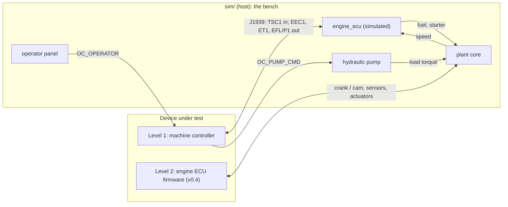
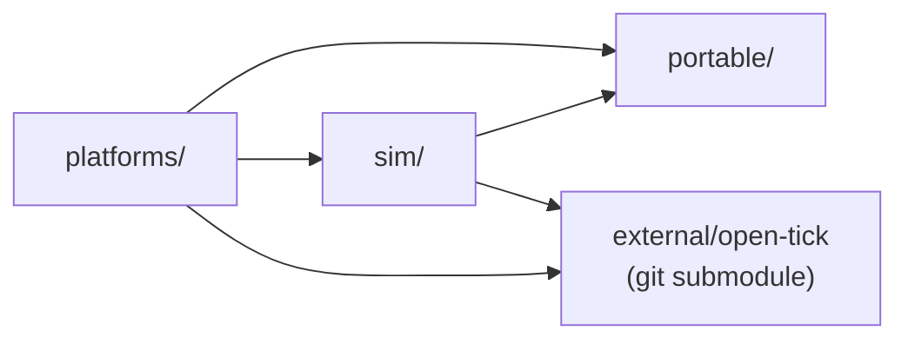

# Architecture

This document explains how open-crank is structured and, for each decision, *why*. Where a decision departs from the earlier README or the first vertical-slice branch, it says so. The interfaces described here are what v0.1 implements; they are not frozen.

## 1. Goals the architecture must serve

1. **The same control source runs on a laptop, in an emulator and on a real board.** This is the reason the project exists. Everything below follows from it.
2. **The plant answers back honestly.** It is physics. It does not secretly help the controller under test.
3. **SIL/HIL parity.** The plant core never knows whether it runs in CI or on an FPGA rig.
4. **Determinism where it matters, and only there.** Tests must be repeatable bit for bit; only the HIL path needs hard real time.
5. **A solo maintainer can keep it in their head.** Small number of modules, narrow interfaces, nothing speculative.

## 2. System overview

Two kinds of device under test (DUT) can face the plant. Level 1 milestones: v0.1–v0.3, v0.5–v0.7, Track R. Level 2: v0.4.



**Why two levels.** In a real engine, the *engine's own ECU* speaks J1939 and the machine's controller talks to it. The first draft let the plant publish J1939 directly and let the "ECU under test" command throttle over CAN, which no real machine does. That blurred who is under test and made a Level 2 future impossible. Making the levels explicit fixes the meaning of every message and shows where the plant ends and the controller begins.

**Why Level 1 first.** EMS and PMS are supervisory controllers, so Level 1 matches the stated use case. It needs only a CAN bus, so it works with `vcan` and no special hardware, and it is where the learning value is cheapest.

**Why the controller drives the pump.** On a real crane the machine controller sits between the operator's lever and the hydraulic pump, and that is where energy-management work happens (power limiting, anti-stall). If the scenario drove the pump directly, the controller under test could never influence its own load. In v0.1 the reference controller passes the lever through and zeroes it outside RUN; the path exists so that better strategies can be developed against it.

## 3. The three zones and the dependency rule



| Zone | Contains | May depend on | Must not contain |
|---|---|---|---|
| `portable/` | J1939 codec, bench messages, machine-controller logic, the Level 2 engine-ECU logic (v0.4) | nothing but `<stdint.h>`, `<stdbool.h>`, `<stddef.h>` | `printf`, `malloc`, files, sockets, OS calls, the plant, `double`, open-tick |
| `sim/` | plant physics, plants, loads, simulated engine ECU, bench, signals, trace columns, J1939 ↔ open-tick frames | `portable/`, open-tick's core, the C standard library | sockets, a specific OS, firmware HALs |
| `platforms/` | host runner, SIL programs, the STM32G4 reference board's firmware (and its `USER CODE` zones for CubeIDE); (later) Renode glue, FPGA glue | `portable/`, `sim/`, open-tick (core and host) | control logic, physics |

**The rule: dependencies point one way, and `portable/` depends on nothing else in the repo.**

**open-tick** ([`external/open-tick`](https://github.com/Open-Heavy-Machinery/open-tick), a git submodule) is the family's machine-independent core: simulated time, scenarios, the scenario player, CAN frames and queues, the trace writer, the pacer, the SocketCAN bridge and the acceptance oracle. open-crank brings the engine. `portable/` never uses open-tick, because firmware must not depend on a host library. `tools/check_portable.sh` already fails on any include from outside `portable/`.

**Why.** Without a hard rule, the reference controller drifts into a Linux program: it picks up `printf`, `atof`, sockets and `double` math, and then it cannot be compiled for the STM32 or run in Renode. That is exactly what happened in the first slice, where the "reference firmware" was a Linux process. A folder boundary plus an enforced rule costs almost no code and protects goal 1.

**Enforcement (CI, not promises): [`tools/check_portable.sh`](tools/check_portable.sh).**

1. `portable/` builds on its own (`portable/CMakeLists.txt`) for Cortex-M4F with [`cmake/arm-none-eabi.cmake`](cmake/arm-none-eabi.cmake): `-mcpu=cortex-m4 -mfpu=fpv4-sp-d16 -mfloat-abi=hard -ffreestanding`, `-Wconversion -Wdouble-promotion` as errors, in Debug and MinSizeRel.
2. Its objects, linked together, may need only `memcpy`, `memmove`, `memset` and `memcmp` from outside. GCC requires those four from every freestanding environment (it emits calls to them for struct copies), so forbidding them would only produce false alarms. Anything else fails, in particular `__aeabi_d*` helpers, which mean a `double` operation emulated in software.
3. Every `#include` in `portable/` names one of the three allowed standard headers or a header inside `portable/`.

**Numeric choices.** `sim/` uses `double`: it is host code and precision is free. `portable/` uses `float`: the STM32G431 has a single-precision FPU, and `double` there is emulated in software and slow. The two are bridged at the boundary (the codec takes physical values as `float`). The whole tree is ISO C11 without GNU extensions, which among other things stops GCC from silently fusing multiply-adds, so host and target results differ only for real reasons.

## 3a. Core, reference and community

The project has three layers:

| Layer | What it is |
|---|---|
| **Shared core** | plants, bench, bus contract, scenarios, fault injection, SIL |
| **Optional reference** | a cheap board with its bill of materials, a guide and example firmware |
| **Community** | everyone's own firmware, on any board, RTOS or language |

Practising critical-firmware techniques is split between the core and the reference:

- What can be checked **over the bus** comes from open-crank, as an acceptance suite for any device under test (v0.2.1).
- What can only be checked **inside the firmware** is shown by the reference firmware (v0.1.x, v0.2): MISRA-oriented checks, stack usage, and the worst observed execution time (measured with the DWT cycle counter; not a proven bound).

## 4. Modules

### 4.1 Plant core (`sim/core`, `sim/plants`)

Physics only. Two dynamic states (crankshaft speed and air-path boost) plus placeholder coolant and oil states:

```
J * dω/dt     = T_ind - T_fric - T_load + T_starter
T_ind         = min(fuel, air) * (T_fl_brake(n) + T_fric(n))      (0 on a stationary shaft)
air           = boost_floor + (1 - boost_floor) * boost
dboost/dt     = (min(fuel, air) - boost) / boost_tau
T_fric        = c0 + c1 * n           (static, up to c0, at standstill)
T_starter     = T_stall * (1 - n / n_no_load)   while engaged, 0 above n_no_load
```

Contract:

```c
typedef struct {
    double fuel_pct;        /* 0..100 % of full-load fuelling, clamped by the plant */
    double load_torque_nm;  /* resistive torque; negative values drive the engine */
    bool   starter_engaged; /* decided outside the plant */
} PlantInputs;

void plant_step(PlantState *s, const PlantParams *p, const PlantInputs *in, double dt);
```

Rules: no I/O, no clock, no allocation, no global state, fixed step. Same inputs give the same outputs, bit for bit.

**Why physics only.** The first slice put an idle governor inside the plant's torque function, so the engine started itself from 0 rpm with no fuel and no starter (it reached about 700 rpm in 2 s). A real engine does not do that, and a hidden governor makes it impossible to tell whether the controller under test or the plant kept the engine alive. The plant must respond; an ECU must decide. For the same reason the starter is now engaged from outside: the first slice's plant dropped it at a hard-coded 400 rpm.

**Why the table is brake torque.** Datasheets give full-load **brake** torque. The first slice treated that table as combustion torque and subtracted friction again, so the engine delivered about 207 kW instead of the class's ~240 kW. Now indicated torque is built as brake plus friction, and a test checks that full fuel gives the table back. The governor break-off region (2200 rpm → 300 Nm) was removed from the physics: the governed ceiling belongs to the ECU.

**Why a second state.** One state already produces droop, recovery, overshoot and stall, but without the turbocharger an engine accepts a load step instantly. That makes the "load step" scenario too easy to pass and leaves nothing for anti-stall logic to work against. The air-path state costs a few lines. Because the turbo spools on burnt fuel, the effective load-acceptance time constant from zero boost is `boost_tau / boost_floor` (about 2.7 s for `d936la6`).

**Why mean-value.** Cycle-resolved combustion is out of scope (see the README's non-goals). Every number needs provenance: [`docs/parameters.md`](docs/parameters.md).

**Level 2 (`sim/l2`, v0.4).** The same plant, stepped every 1 ms, with a crank angle and fuel from the device under test's injector pulses instead of the simulated ECU (`plant_l2.h`):
- **The angle is the bridge's.** open-tick's bridge turns the crank and cam from a 48-bit phase accumulator, 2⁴⁸ = 720°, that gains the step's `crank_phase_inc` every tick of its 27 MHz clock ([bridge-protocol.md](https://github.com/Open-Heavy-Machinery/open-tick/blob/v0.4.0-beta.1/docs/bridge-protocol.md) §3.2). The plant keeps the same accumulator with the same quantised increment (`otk_bridge_phase_inc()`), so its angle equals the bridge's tick for tick, from a freshly loaded bitstream. A capture's start tick gives the exact angle of the injection.
- **Fuel by cylinder.** A linear injector model turns a pulse's width into fuel. An injection counts for a cylinder when it begins inside that cylinder's window around its compression TDC and arrives on that cylinder's channel; each cylinder keeps the fuel of its last counted injection, and a window that closes without one is a misfire, which drops it to zero. The mean of the six goes into `plant_step()` unchanged. A wrong phase (360° off) or a crossed channel therefore burns nothing, and the engine does not run.
- **Late captures.** On a hard run a capture reaches the plant H steps of look-ahead plus a round trip after it happened (the DUT-to-plant delay, [bridge-protocol.md](https://github.com/Open-Heavy-Machinery/open-tick/blob/v0.4.0-beta.1/docs/bridge-protocol.md#2-look-ahead) §2). The plant keeps the last 256 steps, places each capture by its own tick, and judges a window only after `capture_delay_steps`.
- **Why mean-value still.** With that dead time, per-cylinder torque would land in the next cylinder's interval: it would not be faithful. Mean speed control is (bridge-protocol.md §2).
- The wheel, the windows and the injector model are in [`docs/parameters.md`](docs/parameters.md).
- **The in-memory Level 2 loop** (`l2_loop.h`, `open-crank-l2-run`) runs the plant with the reference ECU's logic through a model of the bridge's edges and captures, with the HSI's bias and the DUT-to-plant delay; its scenarios and criteria are in [`docs/acceptance.md`](docs/acceptance.md#level-2-the-engine-ecu-v04). The engine-ECU firmware runs on the board (`platforms/stm32g4/ecu/`, §4.7). **The hard-run runner** (`open-crank-hil`, §4.7) is the same loop with an external ECU (`oc_l2_loop_init_external()`): the plant, the pump and the controller on the host, one step per 1 ms through open-tick's hard loop; the board's injections come back as the bridge's captures, its EEC1 over CAN, and the controller's TSC1 goes out on the bridge's clock. The machine side and the observables are the same code in both, so the criteria are the same. The DUT-to-plant delay a capture can have on the BL616 link is (H + 1) steps, two forwarding cycles and a round trip (open-tick `otk_hard_dut_to_plant_ns()`, 31.2 ms; 29–30 ms measured), and the in-memory loop models it as 30 steps.

### 4.2 Loads (`sim/loads`)

A load is a torque source: `torque = f(command, environment, rpm, dt)`. v0.1 ships a load-sensing variable-displacement hoist pump: the machine controller commands displacement (flow), the load on the hook sets pressure, and

```
T = ratio * Vg_max * displacement * p / (2 * pi * eta_hm)
```

With no function active the pump destrokes to a small standby displacement and holds standby pressure, so its idle torque is small (the first slice held full displacement at standby, about 50 Nm at idle).

**Why a separate module.** Nothing in the core may assume a particular load. Keeping loads outside the plant is how the 2-stroke marine engine will reuse the same core with a propeller instead of a pump.

### 4.3 Simulated engine ECU (`sim/engine_ecu`)

The engine-side brain:

- starter control: cranks while START is held, releases above the running speed, gives up after a time limit
- no fuel below the speed at which it can synchronise
- low-idle governor, and a PI speed governor with anti-windup driven by external speed requests, clamped to the governed range
- optional droop (`droop_pct`, 0 = isochronous), needed for generator-set load sharing in v0.7
- stale requests ignored: after a timeout the engine returns to low idle on its own
- overspeed trip, latched until the engine has stopped
- stall detection
- it reports who controls its speed (J1939 SPN 1483)

States: `OFF` (key off) → `STOPPED` → `CRANKING` → `RUNNING`, and back to `STOPPED` on stall or after a trip.

It lives in `sim/` (host code, `double`), not in `portable/`, because in Level 1 it is part of the *simulated world*, not the device under test. It knows nothing about J1939 frames: the bench decodes TSC1 and hands it an `EngineEcuRequest`. It keeps its own millisecond time, advanced only by its step function.

**Why it exists as its own module.** It is what lets the plant stay pure and the controller under test talk standard J1939. In Level 2 this module is bypassed (the user's firmware replaces it) and the plant receives fuel commands directly through the I/O backend.

**Implemented override modes:** speed control. Torque control and speed/torque limits are treated as "override disabled" (low idle) until they are implemented, and this is documented rather than silently approximated.

### 4.4 J1939 codec and bench messages (`portable/j1939`)

Encode and decode of the v0.1 message set into small structs with `float` physical values. Identifiers are composed and parsed by PGN and destination, not compared as fixed numbers. Encoders saturate (out-of-range values clamp; they never wrap, and NaN maps low); decoders reject frames of the wrong PGN or length and report "not available" and error values as invalid.

| Message | PGN | Direction (seen from the engine) | Rate | Content |
|---|---|---|---|---|
| TSC1 | 0 | in | 10 ms while overriding | override mode (SPN 695), requested speed (SPN 898), requested torque (SPN 518) |
| EEC1 | 61444 | out | 10 ms | torque mode (SPN 899), demand and actual percent torque (SPN 512, 513), engine speed (SPN 190), controlling address (SPN 1483) |
| ET1 | 65262 | out | 1000 ms | coolant temperature (SPN 110) |
| EFL/P1 | 65263 | out | 500 ms | oil pressure (SPN 100) |

Two **bench messages**, which are *not* J1939, use J1939 framing in the Proprietary B range:

| Message | PGN | From | Rate | Content |
|---|---|---|---|---|
| OC_OPERATOR | 65312 (`0xFF20`) | bench, `0xFC` | 20 ms | hand-throttle target speed, hoist lever, fault-reset button |
| OC_PUMP_CMD | 65313 (`0xFF21`) | machine controller | 10 ms | pump displacement command |

Addresses: engine `0x00`, machine controller `0x27`, bench `0xFC`. The first slice used `0x03` for the controller, which is the preferred address of Transmission #1. Byte layouts, timing and engine behaviour are specified in [`docs/bus-interface.md`](docs/bus-interface.md). **These layouts are derived from public sources and must be verified against your copy of J1939-71.** The repo ships no spec text.

**Why four PGNs, not six.** The first README promised "six PGNs" without naming them. A number picked in advance is not a requirement; each message is added when a scenario or test needs it.

**Why TSC1 means what the standard says.** The first slice sent a throttle percentage in the byte that carries requested speed, while declaring "speed control" mode. A real engine would have read about 8000 rpm, which falls in the reserved range. That works only against its own simulator and teaches the wrong protocol.

**Why bench messages.** In Level 1 the device under test only sees the bus. If operator inputs came from a command line or a file, a controller on a real board (v0.2) would have no way to receive them. Over CAN, the same controller works unchanged on a laptop, in Renode and on hardware. They are named `OC_*` and documented as project-specific so nobody mistakes them for J1939.

**TSC1 message counter and checksum** (SPN 4206/4207, since v0.3.1): `j1939_tsc1_checksum()` implements J1939-71's formula. The encoder writes byte 7 from `J1939Tsc1.message_counter`, and the decoder fills `message_counter` and `checksum_valid`. The controller counts; the simulated engine checks.

**DM1 and BAM** (since v0.3.1). In `portable/`, `opencrank/j1939_diag.h` has `j1939_encode_dm1()` and `j1939_decode_dm1()` (lamps and DTCs, J1939-73) and the BAM receiver `J1939BamRx` (J1939-21: sequence checked, T1 750 ms, one message per sender at a time). The BAM sender, `j1939_bam_encode()`, is in `sim/engine_ecu` (`opencrank/j1939_diag_tx.h`), because only the simulated engine sends a DM1 longer than one frame. The controller reads DM1, also as a BAM, and sends its own, always in one frame ([bus-interface.md](docs/bus-interface.md)). Not implemented: the connection-mode transport (RTS/CTS).

### 4.5 Machine-controller core (`portable/machine_ctrl`)

The reference Level 1 controller. It is plain C with no I/O: the platform feeds it every received frame and calls `mc_step()` every 10 ms; it returns the frames to send.

```
WAIT_ENGINE --(valid EEC1, speed >= running for run_confirm)--> RUN
RUN --(EEC1 timeout | overspeed | stall | override not honoured)--> FAULT
FAULT --(fault-reset button press, or mc_clear_fault())--> WAIT_ENGINE
```

In RUN it asks the engine for the operator's target speed through TSC1 (speed control, slew-limited) and passes the hoist lever to the pump. Outside RUN it releases the override (TSC1 mode "disabled"), so the engine returns to its own idle governor, and commands zero displacement. Time is a wrap-safe millisecond counter supplied by the caller.

**Why it checks SPN 1483.** Sending TSC1 is not the same as being in control: the frames can be lost, or the engine can refuse the override. Without the check, a controller would keep "running" a machine it no longer controls. The check also catches the loss of the speed command from the controller's side.

**Why a reference controller at all.** It is both an example for newcomers and the test fixture that proves the interface works end to end. Users are expected to replace it with their own.

### 4.5b Engine-ECU logic (`portable/engine_ecu`, v0.4)

The reference Level 2 engine ECU's logic, the same code for the board's firmware (`oc-stm32g4-ecu`, §4.7) and the in-memory Level 2 loop (§4.1): plain C, `float`, no I/O (`opencrank/ecu.h`). It has two parts with two owners:
- **The wheel** runs in the crank and cam capture interrupt. It takes edge times in ticks of a free-running 32-bit timer, finds the 60−2 gap, counts the teeth, takes the cycle's phase from the cam, measures the speed over 120°, and says which injector to arm on the next tooth's edge, with its delay and width.

  ```
  NONE --(edges)--> SEEKING --(a gap, then another exactly 58 teeth later)--> CRANK --(the cam in its window)--> FULL
  CRANK, FULL --(a gap where none belongs | no gap where one belongs | cam wrong 2 cycles running)--> SEEKING
  any --(no tooth for 100 ms)--> NONE
  ```

  A cam seen in its window while the teeth are counted gives FULL at the second gap, so FULL comes within three revolutions of the first edge from any angle (2.5 at worst in `tests/test_ecu.c`).
- **The governor** runs in the main loop every 10 ms: Level 1's PI law and anti-windup (§4.3) in `float`, low idle or a TSC1 speed request (checksum and counter checked, 200 ms timeout), start fuel until running, an overspeed trip latched until the engine stops, and no fuel outside FULL. It sends EEC1.
- **The hand-over** between the two is the platform's: the wheel's status copied with the interrupt masked, and the commanded width as one 32-bit store ([docs/porting.md](docs/porting.md#the-engine-ecu-level-2)).

**Why the wheel only arms.** The injector's edges are set by a timer in hardware, started by the reference tooth's own edge (`platforms/stm32g4/WIRING-L2.md`), so their jitter is the timer's, not the interrupt's latency. The logic only computes what to arm, one tooth ahead.

**Why the same geometry as the plant.** The wheel's angles (TDC 1 at tooth 10, the cam at 90°, the firing order) are parameters here and constants in `sim/l2`; a test checks that they agree, so the ECU and the plant cannot drift apart.

### 4.6 Runtime (`sim/runtime`)

**Bench.** The simulated machine as seen from the bus: plant, engine ECU and pump, plus the operator panel. `oc_bench_rx()` takes frames from the device under test; `oc_bench_step()` advances one fixed step and returns the frames the machine transmits. The bench is the same code in the tests, in `open-crank-run` and in `open-crank-sil`.

**Time.** The bench owns simulated time as an integer millisecond count and never reads a clock. A **driver** decides how fast that time passes:

| Driver | Used for | Where | Version |
|---|---|---|---|
| free-run | tests, CI, headless runs: as fast as possible, deterministic | `sim/runtime/loop.c`, `platforms/host` | v0.1 |
| paced | interactive SIL: one step per 10 ms of wall clock (soft real time) | `platforms/linux-socketcan`, with open-tick's pacer | v0.1 |
| virtual | emulator-driven: step when the emulator's time says so | open-tick's Track R; `platforms/renode` | Track R |
| hard | FPGA rigs: fixed step with a measured jitter budget | open-tick's bridges; `platforms/fpga` | v0.4 |

**Why the bench owns time instead of reading an abstract clock.** In the first slice the 10 ms step was glued to the wall clock inside `main`, which made CI slow and blocked Renode. The earlier plan was a clock interface (`now`, `wait_until`). That fits free-run and paced, but not an emulator: co-simulating with Renode means "advance by N, then exchange frames" in lockstep, not "wait until T". With a step function that never reads time, every driver is a short loop around the same code.

**What comes from open-tick.** The scenario parser, the player that applies scenario events, the CAN queues of the in-memory loop, the trace writer, the pacer and the SocketCAN bridge. open-crank keeps what is about this machine:

- the bench;
- its signals, registered with open-tick as `OC_SIGNAL_TABLE`;
- the trace columns;
- the conversion between `J1939Frame` and open-tick's frames.

The bench keeps its millisecond time and passes it to the player in nanoseconds (open-tick's timebase). Moving this code changed no behaviour: CI compares the trace of every scenario, byte for byte, against the base branch of each pull request (D19).

**In-memory loop** (`loop.c`). The bench and the reference controller in one process, joined by an in-memory bus: two of open-tick's CAN queues, holding 32 frames each. Every frame goes through the real encoders and decoders; only the socket is missing. Frames from the bench reach the controller in the same step; frames from the controller reach the bench at the start of the next one.

**J1939 ↔ open-tick frames** (`sim/can_otk`). `J1939Frame` lives in `portable/` and never sees open-tick, so the conversion to `OtkCanFrame` and back happens here. Frames J1939 does not use (11-bit identifiers, CAN FD) are dropped on the way in. It is a library of its own so that `open-crank-mc`, which plays the device under test, can use open-tick's CAN bridge without linking the simulator.

**Scenarios** are time-ordered signal changes in plain CSV:

```csv
time_s,signal,value
0.0,key_on,1
0.5,start,1
3.0,start,0
8.0,hoist_demand_pct,85
25.0,end,0
```

| Signal | Meaning |
|---|---|
| `key_on`, `start` | key switch; key held in START |
| `target_rpm` | operator hand throttle |
| `hoist_demand_pct` | operator hoist lever |
| `hoist_load_bar` | pressure the load on the hook requires |
| `fault_reset` | operator fault-reset button |
| `fault.mc_tx_lost` | frames from the device under test are lost |
| `fault.engine_tx_lost` | the engine stops transmitting |
| `fault.ecu_ignores_tsc1` | the engine ECU ignores speed requests |
| `fault.overrun_torque_nm` | external torque driving the crankshaft |
| `fault.engine_dtc_red`, `fault.engine_dtc_amber` | the engine's DM1 reports low oil pressure (SPN 100, FMI 1, red stop lamp) or high coolant temperature (SPN 110, FMI 16, amber lamp); both at once make a two-code DM1, sent as a BAM |
| `test.dut_hang` | test only: the bench sends the frame that hangs the board's hang-test build (watchdog test, `tools/board/watchdog_check.sh`) |
| `fault.link.mc.*`, `fault.link.engine.*` | transport faults of the two links (drop, drop one in N, delay, jitter, corrupt, bus-off): `mc` carries what the device under test sends to the machine, `engine` what the engine sends to it ([docs/acceptance.md](docs/acceptance.md#link-faults)) |
| `end` | end of the scenario |

The parser is open-tick's; times are rounded to the nearest nanosecond, and `end` is reserved by open-tick. Unknown signals, bad numbers, decreasing times and events after `end` are errors with a line number: a typo must fail loudly, not run a different test.

**Why data, not code.** The hoist profile used to be hard-coded in `main.c`. The same scenario must run in CI tests, in the SIL demo, in Renode and on hardware; if it is code, each of those gets its own copy and they diverge. The files in `scenarios/` are the ones the closed-loop tests load. CSV is trivial to read from C and from Python.

**Trace** (`trace.c`). One CSV row per step: inputs, plant, ECU, pump and, when the controller runs in the same process, its state. The 26 columns are declared in a table and written through open-tick's trace writer, which reports a value of the wrong kind or a missing column instead of shifting the columns.

### 4.7 Platforms (`platforms/*`)

Thin glue per target; no control logic or physics.

- `host`: `open-crank-run`, the free-running closed loop. Plain C, builds anywhere.
- `linux-socketcan`: `open-crank-sil` (bench) and `open-crank-mc` (reference controller), each paced by open-tick's pacer on open-tick's SocketCAN bridge. J1939 uses 29-bit classic frames only; `sim/can_otk` drops anything else. `open-crank-ecu-check` (v0.4) drives open-tick's bridge through its hard loop at a constant crank speed, with no plant, and judges where the board's injections land, from the bridge's own accumulator (`tools/board/ecucheck.py`). `open-crank-hil` (v0.4) runs a Level 2 scenario in a closed loop against the board's ECU: the plant's speed to the bridge every 1 ms, the captures back into the plant, TSC1 and EEC1 on the CAN interface, the fidelity check (`sim/l2/fidelity.csv`) before the bridge is opened, and the scenario's criteria on the same observables as in memory (`tools/board/hilrun.py`).
- `stm32g4` (v0.2, built without CubeIDE since v0.2.2, with an IWDG watchdog since v0.3.1): the reference board. Its own CMake project (`platforms/stm32g4/CMakeLists.txt`, cross-compiled with `cmake/arm-none-eabi.cmake`) builds the reference controller, the round-trip echo, the Level 2 harness check and the reference engine ECU (`ecu/`, v0.4) as complete firmware: clock, FDCAN1, HAL configuration and linker script are written here, ST's CMSIS, start-up file and HAL are downloaded at pinned versions and never copied in. CI builds it (job `firmware`); `tools/board/` programs and resets the board with OpenOCD. The `USER CODE` zones for an STM32CubeIDE project stay as the beginners' entry point ([BRINGUP.md](platforms/stm32g4/BRINGUP.md)), not used for tests. See [platforms/stm32g4/README.md](platforms/stm32g4/README.md). Bus-off handling and the watchdog followed in v0.3. The engine ECU (v0.4) runs `portable/engine_ecu`: TIM2 captures the crank and cam and its interrupt is the wheel's context; each injection is a one-pulse timer (TIM1, TIM3, TIM4) started in hardware by the crank edge through `tim2_trgo` → `tim_itr1`, so no injector edge depends on interrupt latency.
- `fpga` *(reserved, v0.4)*: time and I/O backend for hard real time.
- `renode` *(Track R)*: the board's platform description and scripts. The virtual-time driver belongs to open-tick's Track R.

### 4.8 Acceptance (`sim/accept`, oracle in open-tick)

The acceptance suite grades a device under test by the frames it sends ([docs/acceptance.md](docs/acceptance.md)). open-crank brings what is about J1939 and this machine:

- the observables (`sim/accept`): TSC1 and OC_PUMP_CMD decoded into `tsc1_speed_control`, `tsc1_speed_rpm`, `pump_cmd_pct` and `tsc1_override`, and the filter that counts only the DUT's frames (its source address, and a TSC1 addressed to the engine);
- the criteria for each scenario (`scenarios/<name>.accept.csv`);
- the two runners: `open-crank-accept-loop` (`platforms/host`, in memory) and `open-crank-accept` (`platforms/linux-socketcan`, on SocketCAN).

The oracle and the criteria format are open-tick's (`opentick/oracle.h`, since v0.2.0): see its [docs/criteria-format.md](https://github.com/Open-Heavy-Machinery/open-tick/blob/v0.2.0/docs/criteria-format.md) and [ARCHITECTURE.md §3.9](https://github.com/Open-Heavy-Machinery/open-tick/blob/v0.2.0/ARCHITECTURE.md#39-oracle-oracleh).

## 5. Timing model

| Item | v0.1 | Later |
|---|---|---|
| Plant step | 10 ms, explicit Euler | 1 ms (v0.4); revisit the integrator if stiffness appears |
| Simulated ECU | every plant step | same |
| Machine controller | 10 ms (TSC1 and OC_PUMP_CMD every period) | configurable |
| EEC1 / EFL/P1 / ET1 | 10 / 500 / 1000 ms | per J1939 |
| OC_OPERATOR | 20 ms | |
| Timeouts | TSC1 at the engine 200 ms; EEC1 and OC_OPERATOR at the controller 200 ms; pump command 200 ms | |

**A board in the loop (v0.2)** needs no new driver: it runs against `open-crank-sil`, paced by the wall clock, unchanged. Only the bus changes, from `vcan` to a USB-CAN adapter. The plant step drops to 1 ms in v0.4, for Level 2.

**Why 10 ms.** It matches the fastest message period and keeps the loop easy to reason about. The states are slow compared with the step (inertia of the order of 1–3 kg·m², air path of the order of a second), so explicit Euler is adequate. Moving to 1 ms is a configuration change, not a redesign. The controller runs at 10 ms rather than the 20 ms first planned because 10 ms is the TSC1 rate commonly given for engines (verify against J1939-71).

**What the signal generator is actually for.** The plant's equations (tens of states at about 1 kHz) fit easily on a CPU, so v0.4 does *not* put the plant on the signal generator (a second MCU or an FPGA). The signal generator exists for what a PC does poorly: crank and cam waveforms with microsecond jitter, deterministic analog and digital I/O, and timestamped CAN. Plant on a CPU or SoC core, timing on the signal generator: that is the usual HIL split.

## 6. Testing strategy

| Layer | What it checks | Where |
|---|---|---|
| Codec | identifiers, known vectors, round trips, saturation, "not available", short and foreign frames, bench messages | `tests/test_j1939.c` |
| Plant | no self-start, cranking speed, monotonic spin-down, fuel clamping, full fuel gives the brake table, air-path lag, static friction, determinism | `tests/test_plant.c` |
| Pump | torque formula, standby, relief, lag, standstill | `tests/test_hydraulic_pump.c` |
| Engine ECU | key off, fuel enable, start and idle, speed requests, clamping, timeout, override modes, overspeed latch, stall, droop | `tests/test_engine_ecu.c` |
| Controller | state machine, confirmations, slew limit, clamping, timeouts, override check, reset on press, time wrap-around | `tests/test_machine_ctrl.c` |
| Bench, scenarios | message periods, routing, fault switches, links; CSV parser and every shipped scenario file | `tests/test_bench.c`, `tests/test_scenario.c` |
| Closed loop | cold start; load step and release; speed-command loss; engine-status loss; overspeed; ignored override; determinism | `tests/test_closed_loop.c` |
| Portability | `portable/` on Cortex-M4F, symbols, includes | `tools/check_portable.sh` |
| Board firmware | the reference controller and the echo build for the STM32G431KB with the pinned toolchain, with ST's CMSIS and HAL fetched at pinned versions; no CubeMX-generated function in the ELF | `platforms/stm32g4/CMakeLists.txt`, CI `firmware` job |
| Bench check (on a board, run by hand) | bus round trip within limits, every scenario passes with 0 late steps after a software reset each, every reaction within one 10 ms step of the reference bench | `tools/board/bench.sh`, `tools/board/bench_report.py` |
| Undefined behaviour | ASan, UBSan, float-cast-overflow | CI `sanitizers` job |
| Tests can fail | 19 deliberate mutations, each must fail the suite | `tools/mutation_check.sh` |
| Behaviour unchanged by refactors | the trace of every scenario, byte for byte, against the pull request's base branch | `tools/compare_traces.sh`, CI `traces` job |
| SIL on a bus | the README's `vcan` demo as two processes: the controller reaches RUN, holds 1500 rpm within 1 % with and without the hoist load | `tools/vcan_demo_check.sh`, CI `vcan-demo` job |
| MISRA-oriented check | `portable/` against the rules the cppcheck MISRA addon covers; fails on a finding beyond the baseline (counts per rule and file), which goes down as findings are fixed or documented as deviations. Does not imply compliance | `tools/check_misra.sh`, `tools/misra-baseline.txt`, `docs/misra_deviations.md`, CI `misra` job |
| Stack usage | stack per function in the Cortex-M4F MinSizeRel build (`-fstack-usage`), printed largest first, and the worst-case stack of each public controller function along the call graph (`-fcallgraph-info=su`, `tools/stack_budget.py`); fails if a function's stack is not `static`, on recursion, on an indirect call, or above 1024 bytes | `tools/check_portable.sh`, `tools/stack_budget.py`, CI `portable-cortex-m4f` job |
| Board vs SIL | `hoist_step` with the board in the loop vs the wall-clock-paced SIL, within tolerances written down before comparing | v0.2 |
| Acceptance over the bus | any device under test graded by its CAN frames alone, pass/fail per scenario, fifteen scenarios: five of transport faults (one corrupts TSC1, refused by its checksum) and three of engine diagnostics (DM1, one as a BAM); deliberately broken controllers must fail it | `open-crank-accept`, `docs/acceptance.md`, `tools/accept_vcan.sh` (CI `vcan-demo` job), `tools/accept_mutants.sh` (CI `mutation` job) |
| Watchdog (on a board, run by hand) | after a hang the IWDG restarts the board and the controller starts in FAULT until the fault reset (SR-11); the hang exists only in a test build, which CI checks | `tools/board/watchdog_check.sh`, `scenarios/board/watchdog_reset.csv`, CI `firmware` job |
| Safety requirements traced | every `SR-n` of `docs/safety.md` cited by an acceptance criterion or a unit test, and every citation exists | `tools/check_requirements.py`, CI `mutation` job |
| Emulator vs board | the trace in Renode vs the board's, within the stated tolerance | Track R |

Conventions:

- **Tests never use `assert()`.** `CHECK` (`tests/check.h`) always runs, because `assert` disappears under `-DNDEBUG` (typical Release builds) and tests would silently stop testing. CI runs the suite in Release too.
- **Mutation sanity.** A test that cannot fail proves nothing. `tools/mutation_check.sh` breaks each safety-relevant behaviour in a scratch copy (disable the command timeout, unlatch the overspeed trip, keep the pump commanded in FAULT, ...) and requires the suite to fail. When code changes make a mutation pattern stale, the script says so.
- A control regression must fail the build. That is the product promise ("a control regression fails a build instead of a shift").

## 7. Decisions and rationale

| # | Decision | Alternatives considered | Why |
|---|---|---|---|
| D1 | Separate plant physics from engine ECU | Keep a governor inside the plant | A plant that helps hides bugs and blocks Level 2 |
| D2 | Explicit DUT levels (machine controller vs engine ECU) | One undifferentiated "ECU" | Fixes who speaks J1939 and who is under test |
| D3 | Three zones with a one-way dependency, enforced by CI | One flat `src/` | Protects "same code on laptop, emulator and board" |
| D4 | `float` in `portable/`, `double` in `sim/` | `double` everywhere | G431 FPU is single precision |
| D5 | TSC1 used per its standard meaning | Custom throttle frame | Teaches the real protocol |
| D6 | The bench owns simulated time; drivers advance it | Wall clock in `main`; an abstract `now`/`wait_until` clock | Fast deterministic CI; lockstep with an emulator |
| D7 | Scenarios as CSV data, shared by tests, SIL and runner | Hard-coded in `main`; YAML | One scenario everywhere; no parser dependency |
| D8 | Four J1939 PGNs in v0.1 | "Six PGNs" | Add messages when something needs them |
| D9 | `CHECK` macro instead of `assert` | `assert` | Survives Release builds |
| D10 | One repository, one org-level profile | Many repos from day one | Split only when a second consumer exists |
| D11 | Signal generator for timing and I/O, not for the plant: an FPGA (Tang Nano 20K, through open-tick) | Plant on FPGA; a second MCU | The plant is cheap on a CPU; jitter and the number of timed channels are the hard part |
| D12 | Full-load table is brake torque; indicated = brake + friction | Table as indicated torque | Matches datasheets; removes double-counted friction |
| D13 | Air-path state in the plant | One state | Load acceptance is otherwise unrealistically fast |
| D14 | Operator inputs and pump command on the bus (bench messages) | Command-line arguments; scenario drives the pump | A board in the loop only sees the bus; the controller must be able to act on its load |
| D15 | Controller confirms control through EEC1 SPN 1483 | Trust that TSC1 is honoured | Lost frames and refused overrides are real failures |
| D16 | Allow `mem*` in `portable/`, forbid everything else | "No undefined symbols at all" | GCC requires those four in freestanding code; soft-double helpers are what matter |
| D17 | Mutation checks in CI | Manual "break it once" | Keeps proving that tests can fail as code changes |
| D18 | Machine-independent runtime in open-tick, pinned as a git submodule | Keep it here; CMake `FetchContent`; a sibling checkout | A second application needs the same time, scenarios and bridges (the split D10 waited for). A submodule pins the exact commit, so a commit of open-crank always means the same build |
| D19 | Traces compared byte for byte against the base branch in CI | Trust that refactors are refactors | Moving code must not move behaviour; a pull request that changes behaviour on purpose says so with the `behaviour-change` label |

## 8. Migration map from the earlier trees

| Earlier location (README layout / first slice) | New location |
|---|---|
| `core/` | `sim/core/` |
| `plants/d936la6/` | `sim/plants/d936la6/` |
| `loads/hydraulic_pto` | `sim/loads/hydraulic_pump` |
| `j1939/` | `portable/j1939/` |
| `ecu/reference-fw/` | split: logic to `portable/machine_ctrl/`, glue to `platforms/linux-socketcan/mc_main.c` |
| `backends/sil-vcan/`, `io/vcan/` | `platforms/linux-socketcan/` |
| `time/` | `sim/runtime/` (bench time) and open-tick's pacer |
| `sim/runtime/src/scenario.c` (parser), the queues in `loop.c`, the writer in `trace.c` (v0.1) | open-tick `core/` |
| `platforms/linux-socketcan/pacer.c`, `socketcan.c` (v0.1) | open-tick `host/` |
| idle governor inside `d936la6.c` | `sim/engine_ecu/` |
| hoist profile inside `main.c` | `scenarios/*.csv` |

The migration itself is recorded in [ROADMAP.md](ROADMAP.md), section "v0.1".

## 9. Deliberately deferred

- **Generic plant plugin contract.** With one plant, any abstraction would be a guess. Extract it from what the second plant needs (v0.6). The first slice's function-pointer hooks were removed for this reason.
- **Protocol abstraction.** J1939 is the right protocol for the current plant. The 2-stroke uses a different control scheme; separate it then.
- **Level 2 signal layer.** The crank angle, the captured fuel, the in-memory loop and the hard-run runner exist (`sim/l2`, §4.1, §4.7); the analog sensors are *(planned)*.
- **RTS/CTS transport.** After v0.3.1.
- **Smarter reference controller** (power limiting, anti-stall). The interface allows it; the reference stays minimal until the basics are proven.
- **YAML profiles.** When added, they load in `sim/` only. `portable/` never reads files.
- **FMI/FMU export.** Attractive for interoperability; revisit once the plant interface has settled.
- **Aftertreatment, detailed thermal model.** Large modelling effort that does not exercise the skills the project exists for (control loops, protocol, timing). Backlog.

## 10. Known risks

1. **Renode has no STM32G4 platform (Track R).** It does have an `STM32_FDCAN` model, used by its STM32L552 platform, which is probably the same IP as the G4's FDCAN; that is not yet verified. Fallback: an STM32H7 with `MCAN`, which Renode supports officially. The board (v0.2) does not depend on any of this, and the `portable/` zone keeps a change of emulated target cheap, which is also why D3 matters.
2. **USB-CAN latency (v0.2).** The adapter adds its own latency and jitter to every frame, so a trace with the board in the loop cannot match the SIL bit for bit. Mitigation: measure the latency first, then write down the tolerances, then compare, against the SIL paced by the wall clock rather than the free-running tests.
3. **Parameter validity.** The plant is representative, not calibrated. Mitigation: provenance for every parameter, honest wording, hooks for calibration by someone with bench data.
4. **Message layouts from public sources.** Mitigation: every layout is in one place ([`docs/bus-interface.md`](docs/bus-interface.md)) with known test vectors, so a correction from someone with the standard is a small change.
5. **Time synchronisation with an emulator.** Mitigation: the bench never reads a clock (D6); trace comparison against the board in Track R.
6. **Scope.** The vision is large for a small team. Mitigation: milestones with explicit exit criteria and a standing list of non-goals.
7. **A second repository.** A change in open-tick could change open-crank's behaviour. Mitigation: the submodule is pinned, open-crank moves the pin only in a pull request of its own, and the trace comparison (D19) runs on that pull request.
