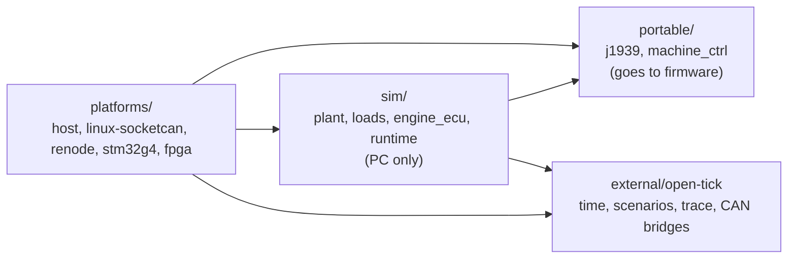

# open-crank

> A heavy-duty diesel that answers back: connect your own firmware over J1939 and practise against an engine you could never keep at home.

Part of [Open Heavy Machinery](https://open-heavy-machinery.github.io) ([open-crank's page](https://open-heavy-machinery.github.io/open-crank/)): open tools to practise and develop embedded control for machines you cannot keep at home, starting with heavy machinery.

**Status: pre-alpha. v0.1 is done and on `main`.** Anything marked *(planned)* does not exist yet. The honest list of what works, what is verified and what is not is in [ROADMAP.md](ROADMAP.md).

`open-crank` is a simulated heavy-duty diesel engine that behaves enough like the real one to develop, test and break control software against it, on a laptop, in CI, and later on a real microcontroller board or an FPGA rig. It speaks SAE J1939 over CAN, the same way a real engine does.

## Why it exists

The barrier to embedded control work on heavy machinery is not knowledge, it is access. A Liebherr D936L A6 or a Mitsui MAN B&W 9S50ME is not something an individual or a small team can keep in the garage, and bench time is expensive and scarce. Most people learning energy-management (EMS) and power-management (PMS) development never get past blinking an LED and sending a torque command to a bench-supply motor. `open-crank` is the missing half of the loop: a plant that answers back.

## Two ways to use it

The plant can sit in front of two different devices under test (DUT). This distinction drives the whole design, so it is stated up front.

| | **Level 1: machine controller** | **Level 2: engine ECU** |
|---|---|---|
| Your firmware is... | the supervisory controller of the machine (crane, vessel, generator set). It *asks* the engine for speed, *reads* its status and drives the machine's loads | the controller *inside* the engine. It reads sensors and commands fuel |
| It talks to the plant via | CAN: J1939 to the engine (TSC1 in, EEC1 / ET1 / EFL-P1 out) plus two documented bench messages (operator controls in, pump command out) | crank and cam signals, analog and digital sensors, actuator outputs *(planned)* |
| Typical real-world analogue | crane controller, EMS, PMS | engine ECU |
| Needs | a CAN bus (`vcan` is enough), or nothing at all for headless runs | microsecond-accurate waveforms: open-tick's Tang Nano 20K bridge *(planned)* |
| Milestones | **v0.1–v0.3, v0.5–v0.7, Track R** | **v0.4** |

EMS and PMS are supervisory controllers, so Level 1 is directly useful for them and is much cheaper to build first.

## What this is

- A **plant model** of a heavy-duty diesel engine: mean-value torque production with turbocharger lag, crankshaft dynamics, a starter, and a load-sensing hydraulic pump load. Detailed thermal, air-path and aftertreatment models are later work.
- A **simulated engine ECU** (starter control, idle and speed governor, limits, overspeed protection, command timeouts), so the plant stays pure physics and your controller faces a realistic engine-side peer.
- A **J1939 peer**: the simulated engine publishes and consumes a small, documented set of PGNs. The full bus contract is in [docs/bus-interface.md](docs/bus-interface.md).
- A **portable reference controller** in plain C, written so the same source can run on the PC, in an emulator and on a real board *(emulator and board: planned)*. CI builds it for a Cortex-M4F on every push.
- **Scenarios as data** and headless closed-loop tests, so a control regression fails a build instead of a shift.
- **Built on [open-tick](https://github.com/Open-Heavy-Machinery/open-tick)**, the family's machine-independent core (simulated time, scenarios, traces, CAN bridges), pinned as a git submodule. open-crank brings the engine.
- **Bring your own firmware.** Any board, RTOS or language that speaks CAN. The bus contract in [docs/bus-interface.md](docs/bus-interface.md) is all it needs.
- **Practise critical-firmware techniques** *(planned)*: acceptance tests over the bus, and a reference firmware showing MISRA-oriented checks, stack and timing analysis and requirement traceability. This is practice, not certification: open-crank is not a certified tool (see below).

## What this is not

Honest non-goals. Revisit these, don't quietly break them.

- **Not a certified tool.** No ISO 26262 or IEC 61508 argument. Models are approximations and always will be. Do not use this to sign off a production calibration, and do not connect any of this to real machinery.
- **Not a digital twin.** The plant is a *representative engine of its class*. Parameters are estimates until a source says otherwise; see [docs/parameters.md](docs/parameters.md).
- **Not a replacement for a test bench.** It is a way to arrive at the bench with working code and a shorter list of things to try.
- **Not crank-angle resolved.** Mean-value models. A cycle-resolved combustion model costs about 100x more and only pays off for injection-timing and knock work.
- **Not a full-vehicle or full-vessel model.** No driveline, chassis, hull or propeller hydrodynamics beyond a load curve.
- **Not a J1939 stack.** We model the engine side and keep the PGN set small. The controller under test brings its own stack.
- **Not (yet) marine, not (yet) PMS.** Both are milestones, not features.

## Reference plants

| ID | Plant | Type | Role |
|---|---|---|---|
| `d936la6` | Liebherr D936L A6-class: 6 cyl. inline, 10.5 L, ~240 kW, hydraulic pump load | 4-stroke CI | **v0.1.** Primary plant |
| `9s50me` | Mitsui MAN B&W 9S50ME-class: 9 cyl., 500 mm bore, propeller load; power and rated speed to be sourced | 2-stroke, single-acting, uniflow-scavenged crosshead, ME electronic control | **v0.6.** Proves the architecture generalises |

The jump between these two is the point of the project: a 4-stroke inline six driving a hydraulic pump and a large two-stroke crosshead engine driving a propeller share almost nothing except a crankshaft. Any abstraction that cannot carry both is the wrong abstraction, and we would rather find out with a second plant than pretend the first one is general.

**Architecture rule:** nothing in the plant core may assume four strokes, a camshaft, an even 720° firing order, or a particular load. Load is a pluggable torque source.

> **Heads-up on the 2-stroke:** a real ME engine's control system does not expose J1939 as its control interface. v0.6 will define its own Level 1 interface for that plant instead of forcing J1939 onto it.

## Architecture in one picture

Three zones with a one-way dependency rule, enforced in CI. Full details in [ARCHITECTURE.md](ARCHITECTURE.md).



`portable/` never includes anything from `sim/`, `platforms/` or open-tick. That is what lets the same control source run on a laptop, in Renode and on a board.

## Repository layout

```text
open-crank/
├── README.md  ARCHITECTURE.md  ROADMAP.md  CHANGELOG.md  LICENSE
├── docs/          parameters.md (provenance), bus-interface.md (Level 1 contract)
├── external/      open-tick (git submodule): time, scenarios, trace, CAN bridges
├── portable/      zone 1: no OS, no libc I/O, no plant. Goes to firmware
│   ├── j1939/       message codec and bench messages
│   └── machine_ctrl/  reference Level 1 controller
├── sim/           zone 2: host-only simulator
│   ├── core/        plant physics (no I/O, no clock)
│   ├── plants/      d936la6/ (plant and its engine-ECU calibration), 9s50me/ (later)
│   ├── loads/       hydraulic pump, propeller (later)
│   ├── engine_ecu/  simulated engine ECU
│   ├── can_otk/     J1939 frames to and from open-tick's CAN frames
│   └── runtime/     bench, signals, in-memory loop, trace columns
├── platforms/     zone 3: per-target glue
│   ├── host/        open-crank-run: headless closed loop
│   ├── linux-socketcan/  open-crank-sil, open-crank-mc
│   ├── renode/      (track R)
│   ├── stm32g4/     (planned, v0.2)
│   └── fpga/        (reserved)
├── scenarios/     operating profiles and fault cases, as CSV
├── tests/         unit and closed-loop tests
├── tools/         portability, mutation, trace-comparison and vcan-demo checks
├── cmake/         toolchain file for Cortex-M4F
└── .github/workflows/
```

## Building

Any host with a C11 compiler and CMake 3.20 or newer. open-tick comes in as a git submodule, so clone with it:

```sh
git clone --recursive https://github.com/Open-Heavy-Machinery/open-crank.git
cd open-crank
```

In a clone made without `--recursive`, run `git submodule update --init` once. Then:

```sh
cmake -S . -B build
cmake --build build
ctest --test-dir build --output-on-failure
```

## Running without a CAN bus

`open-crank-run` runs a scenario closed loop with the reference controller, over an in-memory bus, as fast as the CPU allows (a 25 s scenario takes milliseconds):

```sh
./build/open-crank-run scenarios/hoist_step.csv
./build/open-crank-run scenarios/overspeed.csv --trace overspeed.csv
```

The trace is a CSV with one row per 10 ms step: speed, fuel, torques, ECU state, pump, controller state. The scenarios in `scenarios/` are the same files the closed-loop tests use; see [ARCHITECTURE.md](ARCHITECTURE.md#46-runtime-simruntime) for the signals you can set.

## Running on a virtual CAN bus

The SocketCAN executables need Linux and the `vcan` kernel module. Start the controller first; it waits for the engine:

```sh
sudo modprobe vcan
sudo ip link add dev vcan0 type vcan && sudo ip link set up vcan0
./build/open-crank-mc vcan0                               # terminal 1: reference machine controller
./build/open-crank-sil vcan0 scenarios/hoist_step.csv     # terminal 2: plant, engine ECU, pump, operator panel
candump vcan0                                             # terminal 3: watch the bus
```

To test your own controller instead of `open-crank-mc`, follow [docs/bus-interface.md](docs/bus-interface.md).

## Checks

- `tools/check_portable.sh` builds `portable/` for Cortex-M4F and checks that it needs nothing from outside but `memcpy`/`memmove`/`memset`/`memcmp`, and includes nothing outside itself. Needs `arm-none-eabi-gcc`.
- `tools/check_misra.sh` runs cppcheck's MISRA addon over `portable/` and fails on any finding beyond its baseline, `tools/misra-baseline.txt` (MISRA-oriented: it does not imply compliance).
- `tools/mutation_check.sh` breaks each safety-relevant behaviour on purpose and checks that the tests catch it.
- `tools/compare_traces.sh` runs every scenario with two builds and compares the traces byte for byte. CI runs it on every pull request against its base branch, so a refactor that changes behaviour fails. A pull request that changes behaviour on purpose carries the `behaviour-change` label.
- `tools/vcan_demo_check.sh` runs the `vcan` demo above as two processes and checks that the controller takes control and holds speed through the hoist load.

CI runs all five (the `vcan` demo when the runner provides `vcan`), plus gcc and clang in Debug and Release with warnings as errors, and a sanitizer build.

## Legal and parameters

- **Apache-2.0.** The patent grant matters here; an OEM legal department should be able to read the license and not flinch.
- **SAE J1939 is a paywalled standard.** This repo does not include the spec text. PGN and SPN layouts here are original work from public sources; verify them against your own copy of J1939-71. The two bench messages (`OC_OPERATOR`, `OC_PUMP_CMD`) are this project's own and are not part of J1939.
- **Not affiliated with Liebherr, MAN Energy Solutions or Mitsui E&S.** Engine designations are used nominatively to identify the class of engine being modelled.
- **MISRA C** applies to `portable/` only. The simulator is host code and is not held to it. MISRA rule texts are copyrighted and are not included in this repo.

## Contributing

Pre-alpha, so the fastest way to help is a well-argued issue rather than a pull request. If you have bench access to either reference engine and can correct or source a parameter, say so and cite where the number comes from. If you have the J1939 standard and find a layout that disagrees with [docs/bus-interface.md](docs/bus-interface.md), that is just as valuable.
