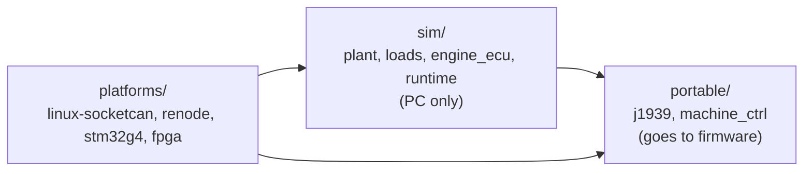

# open-crank

> Open-source heavy-duty diesel engine plant and J1939 test bench, for developing machine controllers from a laptop to an FPGA rig. No engine required.

**Status: pre-alpha, v0.1 in progress.** This README describes the v0.1 target. Anything marked *(planned)* does not exist yet. The honest list of what works and what doesn't is in [ROADMAP.md](ROADMAP.md).

`open-crank` is a simulated heavy-duty diesel engine that behaves enough like the real one to develop, test and break control software against it, on a laptop, in CI, and later on a real microcontroller board or an FPGA rig. It speaks SAE J1939 over CAN, the same way a real engine does.

## Why it exists

The barrier to embedded control work on heavy machinery is not knowledge, it is access. A Liebherr D936L A6 or a MAN B&W 9G95ME-C10.6 is not something an individual or a small team can keep in the garage, and bench time is expensive and scarce. Most people learning energy-management (EMS) and power-management (PMS) development never get past blinking an LED and sending a torque command to a bench-supply motor. `open-crank` is the missing half of the loop: a plant that answers back.

## Two ways to use it

The plant can sit in front of two different devices under test (DUT). This distinction drives the whole design, so it is stated up front.

| | **Level 1: machine controller** | **Level 2: engine ECU** |
|---|---|---|
| Your firmware is... | the supervisory controller of the machine (crane, vessel, genset set). It *asks* the engine for speed and *reads* its status | the controller *inside* the engine. It reads sensors and commands fuel |
| It talks to the plant via | J1939 over CAN (TSC1 in, EEC1 / ET1 / EFL-P1 out) | crank and cam signals, analog and digital sensors, actuator outputs |
| Typical real-world analogue | crane controller, EMS, PMS | engine ECU |
| Needs | a CAN bus (`vcan` is enough) | microsecond-accurate waveforms, so an FPGA or MCU I/O backend |
| Milestones | **v0.1 to v0.3** | **v0.4** |

EMS and PMS are supervisory controllers, so Level 1 is directly useful for them and is much cheaper to build first.

## What this is

- A **plant model** of a heavy-duty diesel engine: mean-value torque production, crankshaft dynamics and a hydraulic-pump load. Thermal, air-path and aftertreatment models are later work.
- A **simulated engine ECU** (idle and speed governor, limits, overspeed protection, command timeouts), so the plant stays pure physics and your controller faces a realistic engine-side peer.
- A **J1939 peer**: the simulated engine publishes and consumes a small, documented set of PGNs.
- A **portable reference controller** in plain C, written so the same source can run on the PC, in an emulator and on a real board *(emulator and board: planned)*.
- A **scenario runner** and headless tests, so a control regression fails a build instead of a shift.

## What this is not

Honest non-goals. Revisit these, don't quietly break them.

- **Not a certified tool.** No ISO 26262 or IEC 61508 argument. Models are approximations and always will be. Do not use this to sign off a production calibration, and do not connect any of this to real machinery.
- **Not a digital twin.** The plant is a *representative engine of its class*. Parameters are estimates until a source says otherwise; see [docs/parameters.md](docs/parameters.md).
- **Not a replacement for a test bench.** It is a way to arrive at the bench with working code and a shorter list of things to try.
- **Not crank-angle resolved.** Mean-value models. A cycle-resolved combustion model costs about 100x more and only pays off for injection-timing and knock work.
- **Not a full-vehicle or full-vessel model.** No driveline, chassis, hull or propeller hydrodynamics beyond a load curve.
- **Not a J1939 stack.** We model the engine side and keep the PGN set small. The controller under test brings its own stack.
- **Not (yet) marine, not (yet) PMS.** Both are milestones, not features.

## Reference plants

| ID | Plant | Type | Role |
|---|---|---|---|
| `d936la6` | Liebherr D936L A6-class: 6 cyl. inline, 10.5 L, ~240 kW, hydraulic pump load | 4-stroke CI | **v0.1.** Primary plant |
| `9g95mec` | MAN B&W 9G95ME-C10.6-class: 9 cyl., ~61.8 MW at 70-80 rpm, propeller load | 2-stroke uniflow, ME electronic control | **v0.5.** Proves the architecture generalises |

The jump between these two is the point of the project: a 4-stroke inline six driving a hydraulic pump and a 60 MW two-stroke driving a propeller share almost nothing except a crankshaft. Any abstraction that cannot carry both is the wrong abstraction, and we would rather find out with a second plant than pretend the first one is general.

**Architecture rule:** nothing in the plant core may assume four strokes, a camshaft, an even 720° firing order, or a particular load. Load is a pluggable torque source.

> **Heads-up on the 2-stroke:** a real ME engine's control system does not expose J1939 as its control interface. v0.5 will define its own Level 1 interface for that plant instead of forcing J1939 onto it.

## Architecture in one picture

Three zones with a one-way dependency rule, enforced in CI. Full details in [ARCHITECTURE.md](ARCHITECTURE.md).



`portable/` never includes anything from `sim/` or `platforms/`. That is what lets the same control source run on a laptop, in Renode and on a board.

## Repository layout

```text
open-crank/
├── README.md  ARCHITECTURE.md  ROADMAP.md  LICENSE
├── docs/          parameters.md, decision records (adr/)
├── portable/      zone 1: no OS, no libc I/O, no plant. Goes to firmware
│   ├── j1939/       message codec
│   └── machine_ctrl/  Level 1 controller logic
├── sim/           zone 2: host-only simulator
│   ├── core/        plant physics (no I/O, no clock)
│   ├── plants/      d936la6/, 9g95mec/ (later)
│   ├── loads/       hydraulic pump, propeller (later)
│   ├── engine_ecu/  simulated engine ECU
│   └── runtime/     clock modes, scenario runner
├── platforms/     zone 3: per-target glue
│   ├── linux-socketcan/
│   ├── renode/      (planned)
│   ├── stm32g4/     (planned)
│   └── fpga/        (reserved)
├── scenarios/     operating profiles as data
├── tests/         unit, closed-loop, golden traces
├── tools/         trace viewer (later)
└── .github/workflows/
```

## Building

Target for v0.1 (CI will validate this before v0.1 is tagged):

```sh
cmake -S . -B build
cmake --build build
ctest --test-dir build --output-on-failure
```

The simulator and the tests run on any host with a C11 compiler and CMake. The SocketCAN backend needs Linux. To try it on a virtual bus:

```sh
sudo modprobe vcan
sudo ip link add dev vcan0 type vcan && sudo ip link set up vcan0
./build/open-crank-sil vcan0        # terminal 1: plant + simulated engine ECU
./build/open-crank-mc vcan0 1500    # terminal 2: machine controller asking for 1500 rpm
candump vcan0                       # terminal 3: watch the bus
```

## Legal and parameters

- **Apache-2.0.** The patent grant matters here; an OEM legal department should be able to read the license and not flinch.
- **SAE J1939 is a paywalled standard.** This repo does not include the spec text. PGN and SPN layouts here are original work from public sources; verify them against your own copy of J1939-71.
- **Not affiliated with Liebherr or MAN Energy Solutions.** Engine designations are used nominatively to identify the class of engine being modelled.
- **MISRA C** applies to `portable/` only. The simulator is host code and is not held to it. MISRA rule texts are copyrighted and are not included in this repo.

## Contributing

Pre-alpha, so the fastest way to help is a well-argued issue rather than a pull request. If you have bench access to either reference engine and can correct or source a parameter, say so and cite where the number comes from.
