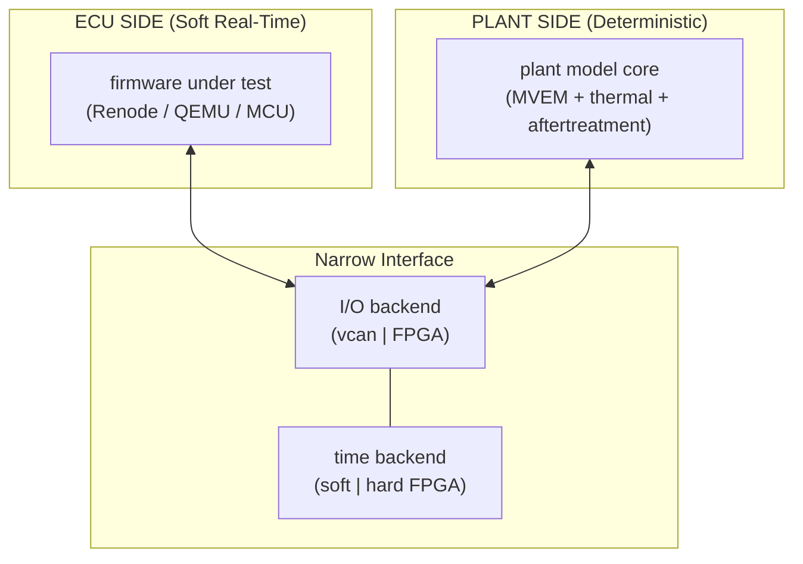

# open-crank

> Open-source HIL/SIL plant simulator for heavy-duty engine ECUs. No engine required.

**Status: pre-alpha.** Nothing runs yet. The repo currently contains a README and a license.
If you are looking for something to `git clone` and use, come back in a few weeks.

`open-crank` is a simulated heavy-duty diesel engine that behaves enough like the real
thing to develop, test and break engine control software against it — on a laptop, in
CI, or on an FPGA rig with real ECUs attached. It speaks SAE J1939 over CAN, exposes
crank and cam position, sensor and actuator interfaces, and can be driven by firmware
running in an emulator or on real silicon.

It exists because the barrier to embedded control work on heavy machinery is not
knowledge, it is access. A Liebherr D936L A6 or a MAN B&W 9G95ME-C10.6 is not something
an individual or a small team can keep in the garage. Bench time is expensive, scarce,
and booked by whoever has the bigger contract. The result is that most people learning
EMS and PMS development never get past blinking an LED and a bench-supply torque
command. `open-crank` is the missing half of the loop.

## Why the name

The first reference plant is the **Liebherr D936L A6**, the superstructure engine of the
Liebherr LTM 1500-8.1 all-terrain crane — a real, in-production 6-cylinder inline
industrial diesel. The crankshaft is where the plant model lives: speed, torque and
angle are the interface the ECU actually cares about.

## Reference plants

| ID | Plant | Type | Role in project |
|----|-------|------|-----------------|
| `d936la6` | Liebherr D936L A6 — 6 cyl. inline, 10.5 L, 240 kW, hydraulic pump PTO | 4-stroke CI | **v0.1 target.** Primary plant, only supported model until v0.3 |
| `9g95mec` | MAN B&W 9G95ME-C10.6 — 9 cyl., 950 mm bore, 3,460 mm stroke, ~61.8 MW @ 70–80 rpm | 2-stroke uniflow, ME electronic control | **v0.5 target.** Proves the architecture generalises |

The jump between these two is the whole point of the project. A 4-stroke inline six driving
a hydraulic pump and a 60 MW two-stroke driving a propeller have almost nothing in common
except a crankshaft. Any abstraction that cannot carry both is the wrong abstraction, and
we would rather find that out with a second plant than pretend the first one is general.

**Architecture rule:** nothing in the core may assume four strokes, a camshaft, a firing
order table with an even 720° cycle, or a propeller-curve load. Load is a pluggable
torque source: hydraulic pump PTO for the crane, propeller law for the marine engine,
dynamometer for bench work.

## What this is

- A **plant model** of a heavy-duty diesel engine with control-relevant dynamics: air path,
  boost, EGR, fuel path, torque production, thermal behaviour, and aftertreatment
  (DOC / DPF / SCR) where it matters for dosing and regeneration logic.
- A **J1939 peer**: the simulated engine publishes and consumes the PGNs a real engine
  would, so the ECU under test sees a normal bus.
- A **harness** for the ECU side: firmware under test runs in an emulator (Renode, QEMU)
  or on real hardware, with a documented I/O mapping between the two.
- A **scenario runner**: scripted operating profiles, fault injection, and assertions that
  run headless in CI so a control regression fails a build instead of a shift.
- A **dashboard** so a human can watch the engine do the wrong thing in real time.

## What this is not

Honest non-goals. Revisit these, don't quietly break them.

- **Not a certified tool.** No ISO 26262 / IEC 61508 argument. Models are approximations
  and always will be. Do not use this to sign off a production calibration.
- **Not a replacement for a test bench.** It is a way to arrive at the bench with working
  code and a shorter list of things to try.
- **Not crank-angle resolved.** Mean-value models. A cycle-resolved combustion model is
  ~100× the cost and only pays off for injection-timing and knock work, which is out of
  scope for now.
- **Not a full-vehicle or full-vessel model.** No driveline, no chassis, no hull, no
  propeller hydrodynamics beyond a load curve.
- **Not a J1939 stack.** The ECU under test brings its own. We model the engine side and
  keep the PGN set small and documented.
- **Not (yet) marine.** The 9G95ME-C10.6 is a milestone, not a current feature.

## Architecture

Two halves that must stay decoupled, joined by a narrow interface. Everything on the left
is soft real-time at most; only the right side ever needs determinism.



- **Time backend.** Soft (wall clock, best effort, CI-friendly) and hard (FPGA, fixed step,
  jitter budget). Both implement the same interface, selected at start-up. SIL must never
  depend on HIL timing and vice versa.
- **I/O backend.** `vcan` / SocketCAN first, FPGA next. Same interface: CAN frames, analog
  channels, digital channels, crank/cam waveform generation.
- **Plant model core.** Deterministic, side-effect free per step, fixed-step integration.
  No allocation in the step loop.
- **MISRA C applies to the ECU side only.** The simulator is host code; it is not held to
  MISRA and pretending otherwise would make it unmaintainable.

### Layout

```text
open-crank/
├── core/        # plant model, physics, state — no I/O, no clock
├── plants/      # d936la6/, 9g95mec/ — parameter sets and plant-specific hooks
├── io/          # vcan/, fpga/ — backend implementations
├── time/        # soft/, hard/ — scheduler backends
├── j1939/       # PGN/SPN definitions and encode/decode, engine side only
├── ecu/         # firmware harnesses, linker maps, emulator configs
├── scenarios/   # operating profiles and fault injection scripts
├── tests/       # CI assertions, golden traces
└── tools/       # dashboard, log viewer, trace diff
```

## Roadmap

- [ ] **v0.1 — vertical slice.** MVEM of the D936L A6, one ECU in Renode, `vcan`, six
      PGNs, dashboard, one CI test that closes a speed-control loop. Nothing else.
- [ ] **v0.2 — aftertreatment.** DOC/DPF/SCR with soot and DEF dosing, regen request logic.
- [ ] **v0.3 — fault injection.** Sensor open/short/plausibility, CAN dropout, limp-home paths.
- [ ] **v0.4 — HIL.** FPGA time backend, real crank/cam waveforms, jitter measurement.
- [ ] **v0.5 — second plant.** 9G95ME-C10.6, propeller load, ME-style electronic control,
      and a PMS scenario. Refactor whatever the second plant breaks.

## Building

Not yet. Follow the roadmap; v0.1 will document a one-command build with no hardware
required. Prerequisites planned: C11 toolchain, CMake, `vcan` kernel module, Renode.

## License

Apache-2.0. The patent grant matters here — an OEM legal department should be able to read
the license and not flinch.

Note that **SAE J1939 is a paywalled standard**. This repo does not include the spec text;
PGN and SPN definitions here are original work derived from public sources and validated
against real equipment where possible.

## Contributing

Pre-alpha, so the fastest way to help is a well-argued issue, not a pull request. If you
have bench access to either reference engine and can correct a parameter set, say so.